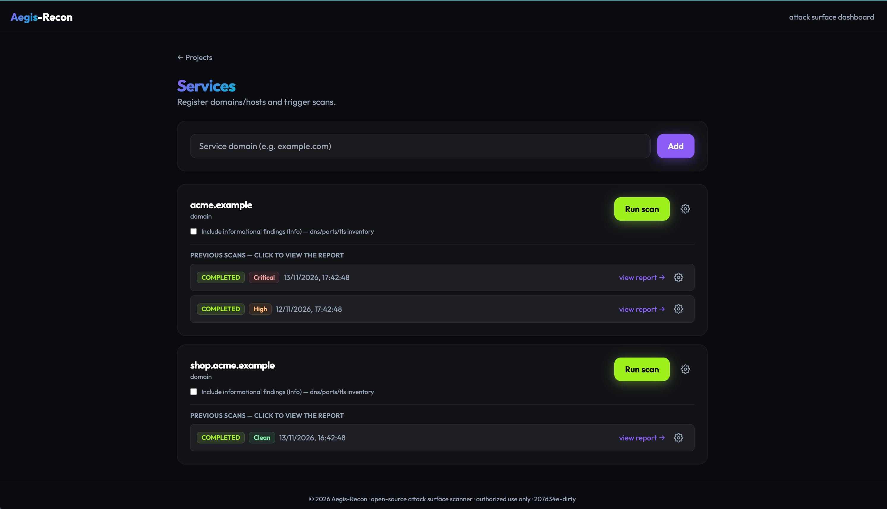
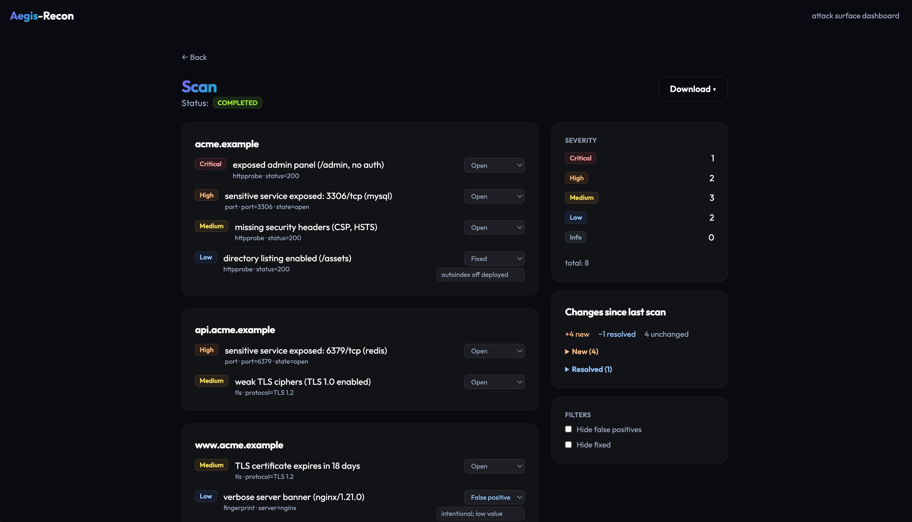

# Aegis-Recon

> Self-hosted attack-surface scanner and security dashboard, written in Go.

Aegis-Recon lets you register your own projects and services, run surface-recon
scans against them, and review the findings in one place. It is built as a clean,
concurrent Go codebase — a single core engine shared by a CLI and an HTTP API,
with a React dashboard on top.

**Status:** 🚧 Work in progress — V1 in development. The engine, CLI, HTTP API,
job queue and dashboard are working end to end; polish items (SARIF export,
release artifacts, coverage) are still open.

---

## What it does

Register a **Project**, add **Assets** (domain, host, web-app, api), trigger a
**surface scan**, and review the **findings** — from the CLI or the dashboard.

A surface scan runs six native-Go modules concurrently:

| Module | What it checks |
|---|---|
| `dns` | A/AAAA/MX/NS/TXT/CNAME records |
| `subdomain` | Passive (crt.sh) + bounded wordlist bruteforce |
| `port` | Concurrent TCP connect scan + banner grab |
| `tls` | Certificate validity, expiry, chain, SAN, ciphers |
| `httpprobe` | Status, redirects, title, security headers |
| `fingerprint` | Technology/stack detection |

Findings export as native JSON or **SARIF 2.1.0** (consumable by GitHub code
scanning and IDEs) — from the dashboard's Download menu or the export endpoint.

No external scan engines — pure Go standard library (`net`, `crypto/tls`,
`net/http`). Results are available as structured JSON (CLI) and through the API.

---

## How a scan runs (two-phase pipeline)

Discovery expands the attack surface; a scope gate keeps it in bounds; then the
probe modules fan out across every in-scope, reachable host with a bounded
worker pool.

```
  domain
    │
    ▼
┌───────────────┐   phase 1: discovery
│  subdomain    │   crt.sh (passive) + bounded wordlist bruteforce
└───────┬───────┘
        │  hosts
        ▼
┌───────────────┐   scope gate (safety)
│  allowlist    │   drop out-of-scope hosts (anti-pivot) + dedup
│  reachable    │   drop hosts that no longer resolve
└───────┬───────┘
        │  in-scope, live hosts
        ▼
┌───────────────────────────────────────┐   phase 2: probe fan-out
│  worker pool (semaphore + WaitGroup)   │   per-host rate limit (anti-DoS)
│  dns · port · tls · httpprobe · fp     │
└───────┬────────────────────────────────┘
        │
        ▼
     findings  (severity + typed evidence)
```

---

## Architecture

```
            internal/engine   (two-phase pipeline, worker pool)
            internal/scanner  (dns, subdomain, port, tls, httpprobe, fingerprint)
            internal/scope    (allowlist + per-host rate limiter)
            internal/store    (SQLite, behind an interface)
                   │
     ┌─────────────┴───────────────────────────┐
     ▼                                          ▼
  aegis (CLI)                           aegisd (HTTP API)
  one-shot scan → JSON                  projects/assets/scans + job queue
                                                │
                                                ▼
                                        web/ (React + Vite SPA)
```

- Mono-repo, single `go.mod`.
- Every probe implements one `Scanner` interface; discovery implements
  `Discoverer`. Resolver and dialer are injected, so modules are unit-tested
  without touching the network.
- SQLite embedded (no CGO), WAL + single-writer, behind a store interface so it
  can be swapped later.
- `aegisd` runs scans through an in-memory job queue (worker pool); scans left
  `PROCESSING` after a restart are re-queued on boot.

### HTTP API

| Method | Path | Purpose |
|---|---|---|
| `GET` | `/health` | Liveness check |
| `POST` / `GET` | `/api/projects` | Create / list projects |
| `PATCH` / `DELETE` | `/api/projects/{id}` | Rename / delete a project (cascade) |
| `POST` / `GET` | `/api/projects/{id}/assets` | Create / list assets |
| `PATCH` / `DELETE` | `/api/assets/{id}` | Rename / delete an asset (cascade) |
| `POST` / `GET` | `/api/assets/{id}/scans` | Trigger / list scans |
| `GET` | `/api/scans/{id}` | Scan status + findings |
| `GET` | `/api/scans/{id}/progress` | Live progress (phase, done/total, log) |
| `GET` | `/api/scans/{id}/export?format=json\|sarif` | Download findings (native JSON or SARIF 2.1.0) |
| `DELETE` | `/api/scans/{id}` | Delete a scan |

---

## Build & run

```bash
# build the Go binaries
make build

# scan from the CLI
./bin/aegis scan example.com

# run the API daemon
./bin/aegisd                 # http://localhost:8080  (GET /health)

# run the dashboard (dev) — in another terminal
cd web && npm install && npm run dev   # http://localhost:5173
```

Or bring up the API + dashboard together with Docker:

```bash
docker compose up --build -d   # start in the background; everything on http://localhost:8080
docker compose logs -f         # follow logs (optional)
docker compose down            # stop
```

Drop `-d` to run in the foreground and watch the logs directly (Ctrl+C stops it).

---

## Screenshots

> Demo data (fake domains). Generate your own with `make seed`.

**Services** — assets per project, each previous scan tagged with its highest
severity (or `Clean`):



**Scan report** — findings grouped by host with a severity summary, change
detection vs the previous scan, and per-finding triage (open / false-positive /
accepted-risk / fixed):



---

## Safety & scope

Aegis-Recon enforces its scanning rules in code, in `internal/scope`, before any
probe runs:

- **Allowlist** — only hosts within the asset's scope are probed; no pivoting to
  hosts discovery turned up but that fall outside scope.
- **GET/HEAD only** on HTTP probes — no state-changing requests.
- **No brute/DoS** — per-host rate limiter, bounded wordlist, bounded
  concurrency.
- **Reachability filter** — hosts that no longer resolve are dropped before
  probing.
- **Typed severity** — `critical | high | medium | low | info`.
- **Structured evidence** on every finding.

---

## Authorized use only

Aegis-Recon performs active network scanning (port scan, subdomain enumeration,
HTTP probing). **Only scan systems you own or are explicitly authorized to test.**
Unauthorized scanning may be illegal in your jurisdiction. As open-source,
self-hosted software, responsibility for how it is used lies entirely with the
operator.

---

## Roadmap

### V1 — Attack surface
- [x] Core engine: concurrent worker pool, injectable resolver/dialer
- [x] Six surface-recon modules
- [x] Two-phase pipeline (discovery → scope gate → probe fan-out)
- [x] SQLite store (WAL, single-writer)
- [x] CLI (`aegis scan <domain>`)
- [x] HTTP API (projects, assets, scans) + job queue — single-user
- [x] React dashboard (live scan progress, findings view)
- [x] SARIF + JSON export (API endpoint + dashboard Download menu)
- [ ] Strong test coverage

### V2 — Vulnerability & platform
- [ ] Vulnerability scan: native checks (headers, weak TLS, cookie flags, exposed files)
- [ ] `nuclei` adapter for OWASP coverage
- [ ] Dependency track / SCA (OSV.dev)
- [ ] Authentication + multi-tenant (`owner_id` already in the schema)
- [ ] Domain-ownership verification (DNS TXT), scheduled scans

---

## License

MIT — see [`LICENSE`](./LICENSE).
