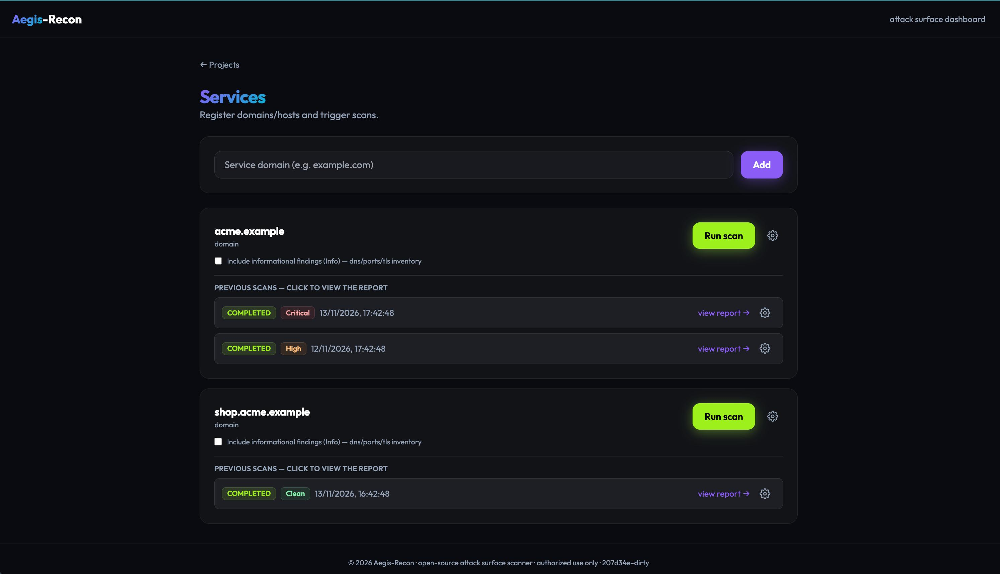
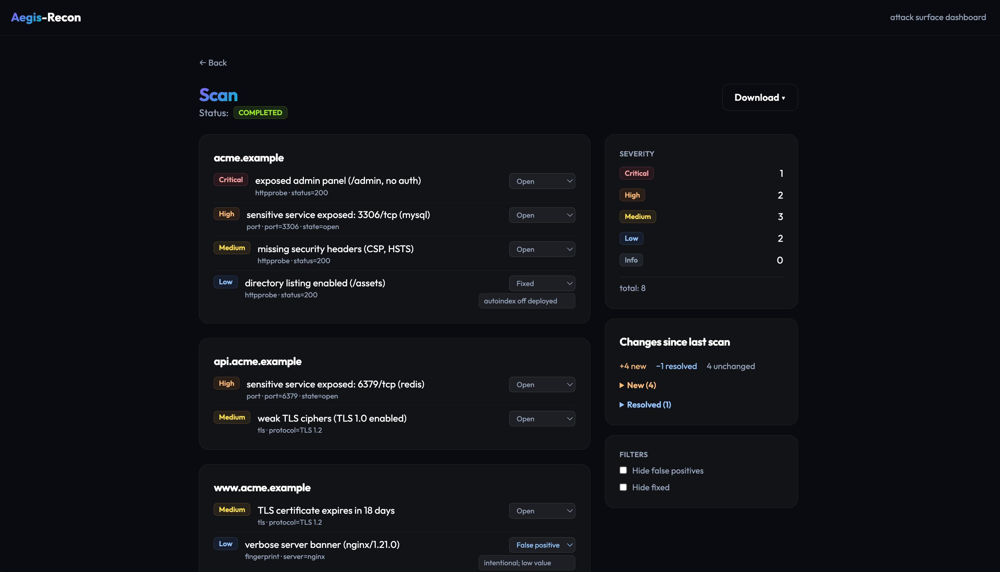

# Aegis-Recon

> Self-hosted attack-surface scanner and security dashboard, written in Go.

Aegis-Recon lets you register your own projects and services, run surface-recon
scans against them, and review the findings in one place. It is built as a clean,
concurrent Go codebase — a single core engine shared by a CLI and an HTTP API,
with a React dashboard on top.

**Status:** V1–V5 are complete and working end to end — engine, CLI, HTTP API, job
queue, React dashboard, SARIF/JSON/CSV/PDF export, scan diffing, finding triage,
scheduled scans, an optional Nuclei adapter (with opt-in intrusive mode), WAF/CDN
detection, endpoint/application checks, email + DNSSEC/AXFR posture, OWASP Top 10
mapping, a read-only MCP server and an aggregate risk dashboard.

---

## What it does

Register a **Project**, add **Assets** (domain, host, web-app, api), trigger a
**surface scan**, and review the **findings** — from the CLI or the dashboard.

A surface scan runs these native-Go modules concurrently:

| Module | What it checks |
|---|---|
| `dns` | A/AAAA/MX/NS/TXT/CNAME records |
| `subdomain` | Passive (crt.sh, with retry + cache) + bounded wordlist bruteforce |
| `port` | Concurrent TCP connect scan + banner grab |
| `tls` | Certificate validity, expiry, chain, SAN, ciphers |
| `httpprobe` | Status, redirects, title, security headers |
| `fingerprint` | Technology/stack detection |
| `cdn` | WAF/CDN detection (header + CNAME heuristics; Cloudflare, Akamai, CloudFront, Fastly, Sucuri, Imperva, …) |
| `emailposture` | SPF / DMARC / DKIM posture (DNS TXT) |
| `dnssec` | DNSSEC signed-zone check + zone-transfer (AXFR) attempt per nameserver |
| `exposedfiles` | Exposed sensitive paths (.git, .env, backups, actuator, swagger, …) with soft-404 baseline |
| `cors` | CORS misconfiguration (reflected origin / wildcard + credentials) |
| `cookies` | Missing cookie flags (HttpOnly / Secure / SameSite) |
| `methods` | Dangerous HTTP methods (PUT/DELETE/PATCH via OPTIONS; TRACE/XST) |
| `openredirect` | Open redirect via common params |
| `hostheader` | Host / X-Forwarded-Host injection reflected in redirect or body |
| `infoleak` | Leaked stack traces + version banners |
| `openapi` | Exposed OpenAPI/Swagger spec → unauthenticated write operations |
| `graphql` | GraphQL introspection enabled |

On top of the scan itself:

- **Change detection** — each scan is diffed against the previous one: findings
  are labelled **new / resolved / unchanged** by a stable fingerprint.
- **Triage** — mark any finding `open / false-positive / accepted-risk / fixed`;
  the verdict is persisted per asset and survives re-scans (triaged findings stop
  resurfacing as "new").
- **Scheduled scans** — run a scan per service on a fixed interval.
- **Risk dashboard** — aggregate severity, triage breakdown and a severity trend
  over recent scans, on the home page.

Findings export as native JSON or **SARIF 2.1.0** (consumable by GitHub code
scanning and IDEs) — from the dashboard's Download menu or the export endpoint.

The recon modules are pure Go standard library (`net`, `crypto/tls`,
`net/http`). Active vulnerability checks are **optional** and powered by an
adapter to [`nuclei`](https://github.com/projectdiscovery/nuclei): it is enabled
per scan (default on), runs under a locked safety profile (no dos/intrusive/
fuzzing templates, rate-limited, per-host timeout) and degrades to a no-op when
the binary is absent. An opt-in **intrusive mode** relaxes that profile (allows
the intrusive/fuzzing classes and enables DAST fuzzing, e.g. user enumeration);
DoS templates stay excluded, and it is authorized-use only. The Docker image
bundles `nuclei` and its templates; outside Docker, install `nuclei` on `PATH` to
use it. Results are available as structured JSON (CLI) and through the API.

---

## How a scan runs (two-phase pipeline)

Discovery expands the attack surface; a scope gate keeps it in bounds; then the
probe modules fan out across every in-scope, reachable host with a bounded
worker pool.

```
  domain
    │
    ▼
┌───────────────┐   phase 1: discovery
│  subdomain    │   crt.sh (passive) + bounded wordlist bruteforce
└───────┬───────┘
        │  hosts
        ▼
┌───────────────┐   scope gate (safety)
│  allowlist    │   drop out-of-scope hosts (anti-pivot) + dedup
│  reachable    │   drop hosts that no longer resolve
└───────┬───────┘
        │  in-scope, live hosts
        ▼
┌───────────────────────────────────────┐   phase 2: probe fan-out
│  worker pool (semaphore + WaitGroup)   │   per-host rate limit (anti-DoS)
│  dns · port · tls · httpprobe · fp ·   │
│  cdn · nuclei (optional)               │
└───────┬────────────────────────────────┘
        │
        ▼
     findings  (severity + typed evidence)
```

---

## Architecture

```
            internal/engine    (two-phase pipeline, worker pool)
            internal/scanner   (dns, subdomain, port, tls, httpprobe, fingerprint, cdn,
                                emailposture, dnssec, exposedfiles, cors, cookies, methods,
                                openredirect, hostheader, infoleak, openapi, graphql, nuclei)
            internal/scope     (allowlist + per-host rate limiter)
            internal/diff      (scan diffing by fingerprint)
            internal/scheduler (interval-based scheduled scans)
            internal/store     (SQLite, behind an interface)
                   │
     ┌─────────────┬───────────────────────────┬───────────────────┐
     ▼             ▼                           ▼                   ▼
  aegis (CLI)   aegisd (HTTP API)        aegis-mcp           web/ (React + Vite)
  one-shot      projects/assets/scans    read-only MCP       SPA on aegisd
  scan → JSON   + job queue              server (stdio)
```

- Mono-repo, single `go.mod`.
- Every probe implements one `Scanner` interface; discovery implements
  `Discoverer`. Resolver and dialer are injected, so modules are unit-tested
  without touching the network.
- SQLite embedded (no CGO), WAL + single-writer, behind a store interface so it
  can be swapped later.
- `aegisd` runs scans through an in-memory job queue (worker pool); scans left
  `PROCESSING` after a restart are re-queued on boot.

### HTTP API

| Method | Path | Purpose |
|---|---|---|
| `GET` | `/health` | Liveness check + version |
| `GET` | `/api/stats` | Aggregate dashboard: totals, severity, triage, per-project, trend |
| `POST` / `GET` | `/api/projects` | Create / list projects |
| `PATCH` / `DELETE` | `/api/projects/{id}` | Rename / delete a project (cascade) |
| `POST` / `GET` | `/api/projects/{id}/assets` | Create / list assets |
| `PATCH` / `DELETE` | `/api/assets/{id}` | Update (name, scope, blacklist) / delete an asset (cascade) |
| `GET` / `PUT` | `/api/assets/{id}/schedule` | Get / set the scheduled-scan interval |
| `PUT` | `/api/assets/{id}/triage` | Set a finding's triage status (by fingerprint) |
| `POST` / `GET` | `/api/assets/{id}/scans` | Trigger / list scans (list includes top severity) |
| `GET` | `/api/scans/{id}` | Scan status + findings (with fingerprints) + triage map |
| `GET` | `/api/scans/{id}/diff` | Diff vs the previous completed scan (new/resolved/unchanged) |
| `GET` | `/api/scans/{id}/progress` | Live progress (phase, done/total, log) |
| `GET` | `/api/scans/{id}/export?format=json\|sarif` | Download findings (native JSON or SARIF 2.1.0) |
| `DELETE` | `/api/scans/{id}` | Delete a scan |

---

## Build & run

```bash
# build the Go binaries
make build

# scan from the CLI
./bin/aegis scan example.com

# run the API daemon
./bin/aegisd                 # http://localhost:8080  (GET /health)

# run the dashboard (dev) — in another terminal
cd web && npm install && npm run dev   # http://localhost:5173

# optional: load demo data (fake domains) for a populated dashboard
make seed
```

The Docker image bundles `nuclei` and its templates, so active vulnerability
checks work out of the box; run the binaries directly and they are used only if
`nuclei` is on `PATH`.

Or bring up the API + dashboard together with Docker:

```bash
docker compose up --build -d   # start in the background; everything on http://localhost:8080
docker compose logs -f         # follow logs (optional)
docker compose down            # stop
```

Drop `-d` to run in the foreground and watch the logs directly (Ctrl+C stops it).

---

## Screenshots

> Demo data (fake domains). Generate your own with `make seed`.

**Services** — assets per project, each previous scan tagged with its highest
severity (or `Clean`):



**Scan report** — findings grouped by host with a severity summary, change
detection vs the previous scan, and per-finding triage (open / false-positive /
accepted-risk / fixed):



---

## Safety & scope

Aegis-Recon enforces its scanning rules in code, in `internal/scope`, before any
probe runs:

- **Allowlist** — only hosts within the asset's scope are probed; no pivoting to
  hosts discovery turned up but that fall outside scope.
- **GET/HEAD only** on HTTP probes — no state-changing requests.
- **No brute/DoS** — per-host rate limiter, bounded wordlist, bounded
  concurrency.
- **Reachability filter** — hosts that no longer resolve are dropped before
  probing.
- **Typed severity** — `critical | high | medium | low | info`.
- **Structured evidence** on every finding.

The native recon path is GET/HEAD only. The optional Nuclei adapter performs
active checks, but runs under a locked profile (no dos/intrusive/fuzzing
templates, rate-limited, per-host timeout) and is opt-in per scan.

---

## Authorized use only

Aegis-Recon performs active network scanning (port scan, subdomain enumeration,
HTTP probing). **Only scan systems you own or are explicitly authorized to test.**
Unauthorized scanning may be illegal in your jurisdiction. As open-source,
self-hosted software, responsibility for how it is used lies entirely with the
operator.

---

## Roadmap

### V1 — Attack surface ✓
- [x] Core engine: concurrent worker pool, injectable resolver/dialer
- [x] Surface-recon modules (dns, subdomain, port, tls, httpprobe, fingerprint)
- [x] Two-phase pipeline (discovery → scope gate → probe fan-out)
- [x] SQLite store (WAL, single-writer)
- [x] CLI (`aegis scan <domain>`)
- [x] HTTP API (projects, assets, scans) + job queue — single-user
- [x] React dashboard (live scan progress, findings view)
- [x] SARIF + JSON export (API endpoint + dashboard Download menu)

### V2 — Vulnerability & platform ✓
- [x] Change detection: diff each scan vs the previous (new/resolved/unchanged) by fingerprint
- [x] Triage workflow: per-finding `open / false-positive / accepted-risk / fixed`, persisted per asset
- [x] Scheduled scans (fixed interval per service)
- [x] Vulnerability scan via a `nuclei` adapter (optional, locked safety profile, Docker-bundled)
- [x] WAF/CDN detection (header + CNAME heuristics)
- [x] Aggregate risk dashboard (severity, triage, trend)
- [x] Per-asset scan blacklist

### V3 — Platform, notifications & security detection ✓
- [x] Persisted settings + encrypted secrets; email (SMTP) + webhook notifications
- [x] Single-admin auth (session cookie); YAML config + configurable port
- [x] Global findings page; dashboard drill-down (project → service)
- [x] CSV + PDF export; scan retention cap
- [x] Email posture (SPF/DMARC/DKIM) + sensitive-file exposure detection

### V4 — Endpoint & application analysis ✓
- [x] CORS, cookie flags, dangerous methods, open redirect, host-header injection
- [x] Info/version leak; OpenAPI spec risk (unauthenticated write ops); GraphQL introspection

### V5 — Reporting & active detection ✓
- [x] Read-only MCP server (query the posture via an LLM over stdio)
- [x] Branded PDF report + per-service export filenames; per-finding remediation guidance
- [x] DNSSEC check + zone-transfer (AXFR) attempt per nameserver
- [x] Nuclei intrusive mode (opt-in, DAST/fuzzing; DoS stays excluded)
- [x] OWASP Top 10 (2021) mapping per finding + breakdown

### Backlog
- [ ] Authentication multi-tenant / SCA (OSV.dev) / ownership verification
- [ ] MCP with actions (trigger scan / set triage)

---

## License

MIT — see [`LICENSE`](./LICENSE).
